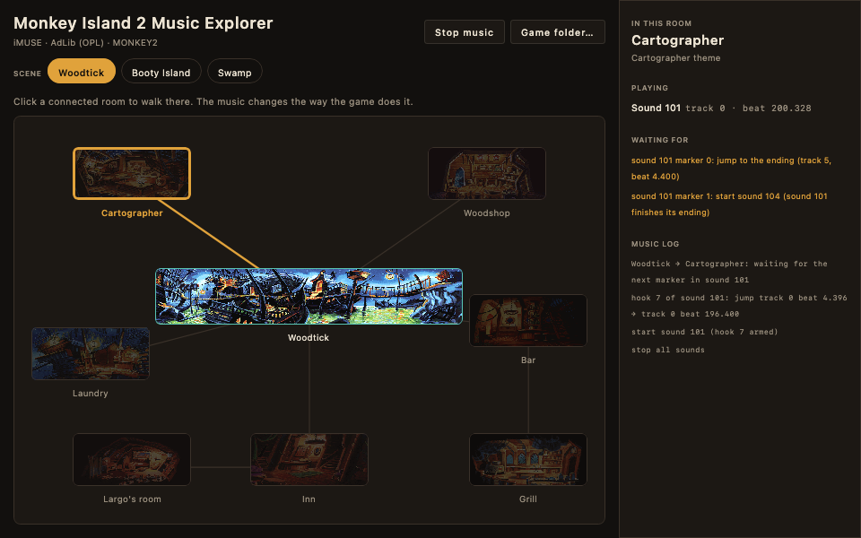
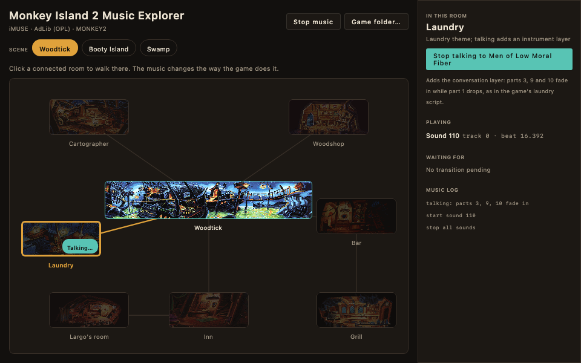
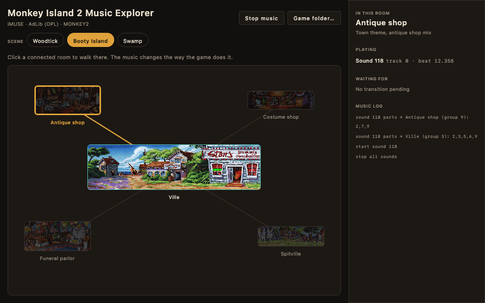
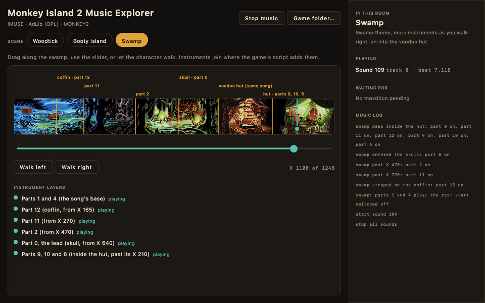

# Monkey Island 2 Music Explorer

Walk around scenes of *Monkey Island 2* and hear how its iMUSE music changes, played through an emulated AdLib (OPL2)
card. Click a connected room and the music changes the way the game's own scripts change it: the song waits for the
right moment, plays an ending, and the next one begins under it. Scenes so far: **Woodtick**, **Booty Island** and the
**swamp** with the voodoo hut, where instruments join as you walk.

It reads your own copy of the game, so no game files are included. You need the **DOS AdLib version** of *Monkey
Island 2* (the folder with `MONKEY2.000` and `MONKEY2.001`).

<table>
  <tr>
    <td><br><sub>Woodtick: a transition waiting for its marker</sub></td>
    <td><br><sub>The laundry: <i>Talk to Men of Low Moral Fiber</i> adds a layer</sub></td>
  </tr>
  <tr>
    <td><br><sub>Booty Island: one song, a different mix per shop</sub></td>
    <td><br><sub>The swamp: instruments join as you walk into the hut</sub></td>
  </tr>
</table>

## Download

Every commit to `main` publishes fresh installers on the **[Latest release](https://github.com/kelmer44/imusePlayer/releases/tag/latest)**:

- `MI2-Music-Explorer-macos-arm64.dmg` for Apple Silicon Macs
- `MI2-Music-Explorer-windows.msi` for Windows

They are not code-signed, so macOS and Windows warn the first time you open them. Open the app, choose your *Monkey
Island 2* folder, and click a room.

## Build from source

You need JDK 17. On Windows, building the `.msi` also needs [WiX](https://wixtoolset.org).

```bash
./gradlew runWoodtick -Pgame="/path/to/MONKEY2"   # run it (the game folder is optional; the app asks otherwise)
./gradlew packageDmg                              # macOS installer
./gradlew packageMsi                              # Windows installer, build on Windows
```

## How it works

See [docs/TECHNICAL.md](docs/TECHNICAL.md) for how the music behaviour was read out of the game's scripts, what each
scene does, what is not reproduced, and the test and helper tools.

## Licence

Free software under the **GNU General Public License, version 3 or (at your option) any later version**; see
[LICENSE](LICENSE). It is built on ScummVM's iMUSE and AdLib code and on Nuked OPL3; the full credits and the licences
of the libraries are in [THIRD_PARTY.md](THIRD_PARTY.md).

*Monkey Island* and *LucasArts* belong to their owners. This project is not affiliated with or endorsed by them.
The screenshots show room pictures from the game, and the app icon is the LucasArts logo, for illustration only.
